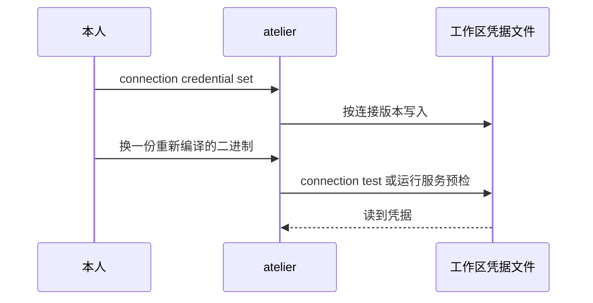
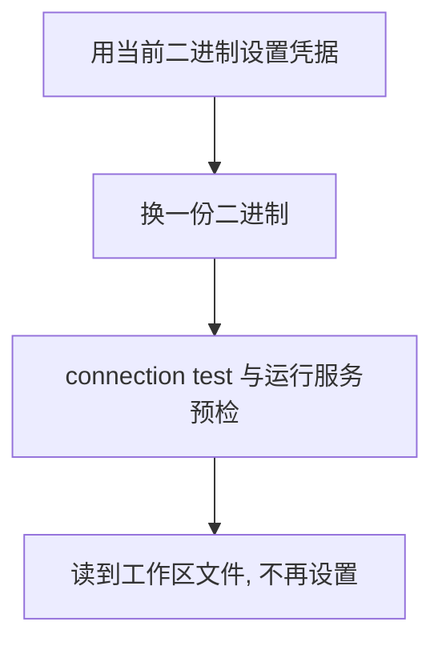
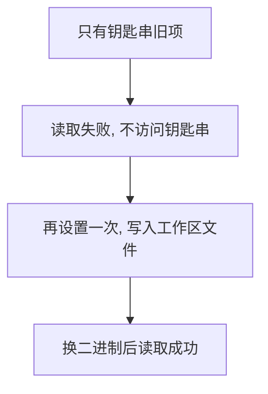

# L1 产品设计：重新编译后仍能读取已保存的 API 凭据

版本：v0.3，2026-10-11；状态：Draft。关联 [Issue #24](https://github.com/xforce-io/atelier/issues/24)、[名词表](../../glossary.md)。L2：[technical.md](technical.md) v0.2。目录名保留 `24-stable-signing-identity`，不表示签名身份。

确认来源：2026-10-11 本人在本会话确认，先走工作区文件，不走钥匙串，先把单机能力跑通。这取代 v0.1 的签名身份和 v0.2 的放宽钥匙串访问。

## 1. 背景与目标

API 凭据原先只在 macOS Keychain。设置时钥匙串记下当时那一份二进制，重新编译后读不到，运行服务的投递被挡住。

目标：仍用 `connection credential set` 设置。秘密写在工作区文件里。重新编译、换目录或回滚后的二进制直接读取，重新设置 0 次，不弹窗。

## 2. 范围与非目标

本次交付：

- 新设置的 API 凭据写入工作区文件，按连接版本分开。
- 任意一份能读该工作区的 atelier 二进制都能读取。
- 数据库、命令输出和日志不含秘密。

不做：

- 钥匙串读写，包括读取本变更前留在钥匙串里的项。
- 签名身份、签名构建、新的检查命令。
- agent CLI 登录材料（仍在 `cli-environments/<id>/login`）。
- 从环境变量自动发现凭据。
- 非本机能力验证之外的访问控制收紧。

## 3. 用户与产品概念

以名词表为准。本人用现有命令设置凭据，然后换二进制继续用同一工作区。

| 对象 | 持续保存的事实 | 与其他对象的关系 |
|---|---|---|
| API 凭据文件 | 工作区 `credentials/` 里的秘密，一个连接版本一份 | 数据库只存引用和代次 |
| 旧钥匙串项 | 本变更前写入钥匙串的秘密 | 不再读取。要继续用，再设置一次，写入文件 |

## 4. 产品交互总览

对应 S1。旧钥匙串项不会出现在文件里，再设置一次后回到上图，对应 S2。

## 5. 信息架构与入口

不新增入口。设置仍是 `connection credential set <连接 ID> --revision <版本> --stdin`，并带 `--request-id`。读取仍是 `connection test` 和 `runtime start` 的预检。普通 `cargo build` 仍是日常构建。

拷走、打包或提交工作区目录时，凭据文件会一起走。

## 6. Stories 与完整交互

### S1. 设置之后，换二进制仍能读取

角色：本机本人；工作区运行服务。前置：用包含本变更的二进制对工作区设置了该连接版本的 API 凭据。入口：`connection credential set`，然后 `connection test` 或 `runtime start`。

操作：设置凭据；重新编译或换上另一份二进制；用新二进制执行 `connection test`，并用它启动运行服务领取一条待投递。

反馈：连接检查不再因读不到凭据而失败；运行服务预检读到凭据，投递不因凭据阻塞。凭据代次只在设置时变化。输出不含秘密。

成功终点：换二进制不需要再设置。

本图对应 S1，验收 S1.A1、S1.A2。单路径，无分支。

### S2. 钥匙串里的旧凭据再设置一次

角色：本机本人。前置：该连接版本的凭据只在钥匙串里，工作区还没有对应文件。入口：`connection test`，然后 `connection credential set`。

操作：用当前二进制读取；再设置一次；换一份二进制再读取。

反馈：第一次读不到，按凭据缺失失败，不访问钥匙串。再设置 1 次后，第二次读取符合 S1。

本图对应 S2，验收 S2.A1。

## 7. 产品规则与边界

- R1. 秘密在工作区 `credentials/` 的文件里。数据库、日志、命令输出和错误文本不含秘密。
- R2. 一个连接版本一份文件。换二进制读取同一文件。
- R3. 不读、不写钥匙串。旧项不会自动出现在文件里。
- R4. 清除选定版本时删除该次清除记下的文件。换代后的旧文件保留，供原设置请求重放核对。
- R5. 不新增命令。

## 8. 验收与效果验证

验收用临时工作区和合成凭据，不碰本人正在运行的运行服务和真实凭据。功能地图：[setup-and-intake.md](../../../.agents/skills/verify-atelier/features/setup-and-intake.md) 的 S1.A18。

| ID / 关联 | 前置 | 入口与操作 | 可判定结果 | 异常与禁止 | 证据 / 执行 / 属性 |
|---|---|---|---|---|---|
| S1.A1 / S1 / R1、R2 | 二进制 A 对临时工作区设置合成凭据 | 二进制 B 执行 `connection test` | 不再因凭据缺失或不可读失败；代次不变；输出和数据库不含秘密 | 不得要求再设置；不得访问钥匙串 | 连接检查结果、凭据代次、数据库检索。可执行。必需 |
| S1.A2 / S1 / R2 | 同上 | 二进制 B `runtime start` 并领取一条待投递 | 预检读到凭据，投递不因凭据阻塞 | 不得打开凭据恢复事项 | `runtime status`、投递查询。可执行。必需 |
| S2.A1 / S2 / R3 | 数据库有引用但工作区没有文件 | `connection test`；再设置一次；另一份二进制再测试 | 第一次失败且不读钥匙串；再设置 1 次后第二次通过凭据读取 | 不得从钥匙串搬迁 | 连接检查与凭据设置记录。可执行。必需 |

## 9. 折衷与开放问题

拷走工作区即拷走凭据。这是现阶段接受的结果。没有待定问题。
